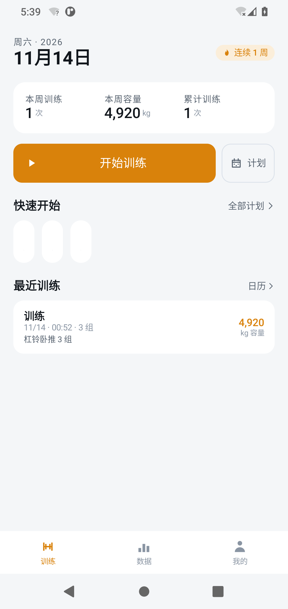
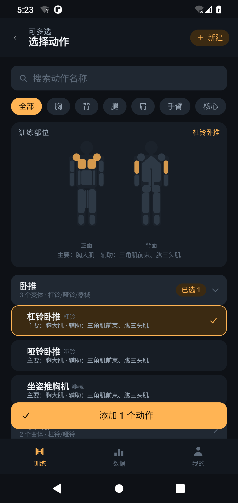
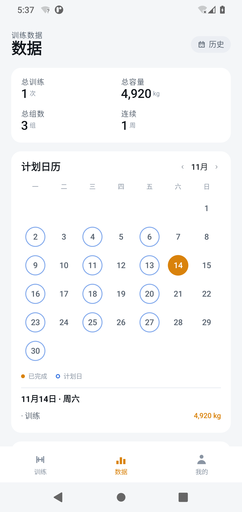
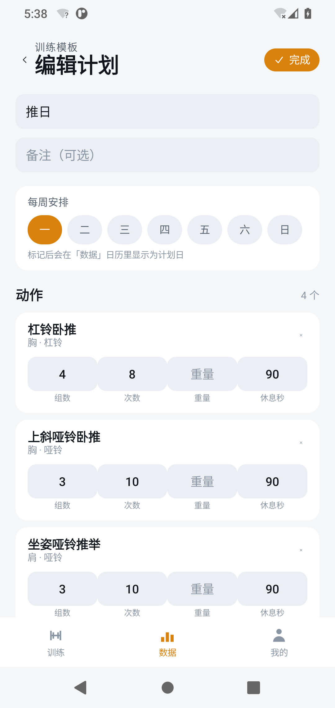
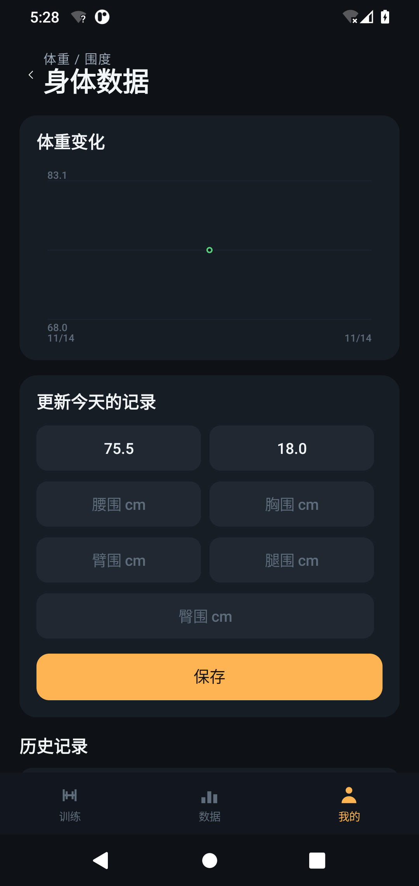
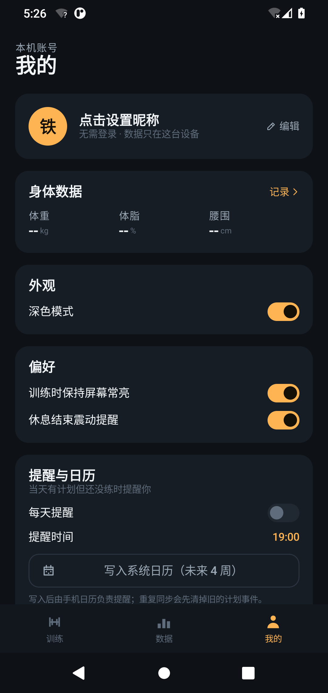

# 铁记 IronLog

一个完全离线的健身训练记录 App。**没有注册、没有登录、没有内购、没有广告、不联网**——装完打开就能用。

这是独立实现的同类工具，不是对「训记」的修改版：代码、界面、图标全部新写，没有使用任何第三方 App 的代码或素材。

---

## 安装

1. 把 `dist/IronLog-1.0.0.apk` 传到手机上（微信/QQ 传文件、数据线、网盘都行）。
2. 点开安装，首次会让你允许「安装未知来源应用」，允许即可。
3. 桌面出现「铁记」图标，打开直接进入训练页。

要求：Android 8.0（API 26）及以上。

## 功能

### 训练

- 一键开始空白训练，或从训练计划一键开练
- **先选动作、再点「开始训练」**，挑选动作的时间不算进训练时长
- **支持暂停/继续**（暂停期间计时冻结，不会算进训练时长）
- 全程自动保存，退出 App 也不丢
- 每个动作独立记录：重量、次数、每组完成勾选
- 组类型：正式组 / 热身组 / 递减组（长按组号切换）
- 组间休息倒计时，结束震动提醒，可跳过
- 显示「上次」成绩，方便对照加重
- 动作备注、训练备注、休息时长按动作单独设置
- 训练中可随时加动作、换动作、删动作
- 首页「最近训练」每一条会列出**当天练了哪些动作、各做了几组**，不用点进去才知道

### 动作库

- 内置 95 个动作，7 大肌群（胸/背/腿/肩/手臂/核心/有氧）分类
- **每个动作都标注了主要肌肉与协同肌肉**，不是只写一个大肌群。例如：
  - 杠铃卧推 → 主要：胸大肌；辅助：三角肌前束、肱三头肌
  - 上斜哑铃卧推 → 主要：胸大肌上部
  - 杠铃划船 → 主要：背阔肌、菱形肌；辅助：斜方肌、肱二头肌、竖脊肌
  - 阿诺德推举 → 主要：三角肌前束、中束
- **同一动作的器械变体合并成一组**（如「卧推」下含杠铃卧推、哑铃卧推、坐姿推胸机），点击组标题展开，列表不会一屏塞几十行
- 按肌群筛选、按名称搜索
- 选中某个动作时，顶部正反两面人体图会**逐块点亮**这个动作练到的肌肉（胸/背/肩/手臂/核心/腿细分成 16 个部位，不是整块涂色）
- 支持自建自定义动作

### 计划与日历（在「数据」页）

- 训练模板：动作 + 目标组数/次数/重量/休息
- **按分化一键生成**：全身 2 练 / 全身 3 练 / 上下肢 4 练 / 推拉腿 3 练 / 推拉腿 6 练 / 五分化 5 练，动作和组数已填好，生成后随便改
- 每个计划可以设置**每周固定哪几天练**
- 月历里：实心点 = 当天已训练，空心圈 = 当天有计划
- 点某一天，能看到当天的计划和完成情况，没完成的直接「开始」
- 计划可以随时编辑、删除、直接开练

### 历史

- 月历视图，有训练的日子带圆点
- 按天查看、按月查看，进入详情看每组数据
- 删除记录、补写备注

### 数据统计

- 总训练次数、总容量、总组数、连续训练周数
- 估算 1RM 力量趋势曲线（Epley 公式），可切换动作
- 最近 8 周容量柱状图
- 肌群容量占比
- 个人记录（PR）排行

### 身体数据

- 体重、体脂、腰围、胸围、臂围、腿围、臀围
- **今天与往日分开**：默认记录今天；点历史里的任意一条，表单切换到那一天，改的是那条旧记录，不会覆盖今天
- 编辑往日数据时，右上角有「回到今天」按钮
- 体重变化曲线、历史记录

### 提醒与系统日历联动

- **每天提醒**：到设定的时间，如果当天有计划但还没练，发一条通知催你
- 提醒时间是**滚筒选择器**（小时 0–23、分钟 0–59 两列滚轮）
- **写入系统日历**：把未来 4 周的计划写成日历事件（带提前 15 分钟提醒），交给手机自带的日历 App 负责通知
- 重复写入会先清掉旧的 IronLog 事件，不会堆一堆重复日程

### 外观

- **深色 / 浅色模式**，在「我的」里一键切换，切换后**停留在当前页面**，不会跳回训练页
- 底部导航、固定标题栏、图表网格线都有独立配色，浅色下不是简单反色

### 数据

- 一键导出 JSON 备份（系统文件选择器，存到任意位置）
- 导入备份恢复（换机用）
- 清空全部数据

## 应用逻辑（状态与判定规则）

这一节是行为契约。改代码前先看这里，改完如果规则变了就同步改这里。

### 数据模型

```
WorkoutSession（一次训练）
  ├─ startedAt / endedAt / pausedAt / pausedAccumMs
  ├─ routineId（从计划开练时记录，用于判断"计划完成"）
  └─ SessionExercise[]（动作条目）
       ├─ exerciseId, restSec, note
       └─ SetEntry[]（组）
            ├─ weight (kg), reps
            ├─ done      是否算完成
            └─ type      NORMAL / WARMUP / DROP
```

层级不能拍平：按动作查历史、算 PR、算肌群分布都依赖"训练 → 动作 → 组"这条链。

### 动作与肌肉数据

```
Exercise
  ├─ id          永久不变，历史记录靠它解析（改了就等于删动作）
  ├─ muscle      大肌群，只用于筛选（胸/背/腿/肩/手臂/核心/有氧）
  ├─ family      器械变体分组键，如"卧推"下含杠铃/哑铃/器械三个变体
  ├─ primary     主要肌肉，逗号分隔，用于人体图点亮与文案
  └─ secondary   协同肌肉
```

- 人体图按 16 个部位绘制（胸、腹直肌、腹斜肌、前/中/后三角、肱二头、肱三头、前臂、背阔、斜方、竖脊、臀、股四头、腘绳、小腿、内收），`primary`/`secondary` 里的肌名映射到这些部位
- 肌名后缀"上部/下部/中部/长头/短头"在映射时会剥掉，因此"胸大肌上部"和"胸大肌"点亮同一块
- `family` 允许跨两个 `muscle`（硬拉同时属于背和腿，耸肩同时属于背和肩）；因为分组发生在筛选后的列表里，同一个分组头不会把不同肌群的动作混在一屏

### 身体数据

- 以"日期"为主键，同一天重复保存 = 更新那一条
- 编辑历史记录（点历史行）只改那一天，不会写到今天
- 体重曲线只取 `weight > 0` 的记录

### 训练会话状态机

| 状态 | 判定 | 行为 |
|---|---|---|
| 空草稿 | `startedAt == 0` 且无动作 | 返回或下次启动时自动丢弃，不产生幽灵记录 |
| 准备中 | `startedAt == 0` 且已有动作 | 已经选好动作，等用户点「开始训练」，**不计时** |
| 进行中 | `startedAt > 0` 且 `endedAt == 0` | 可继续编辑，自动保存 |
| 暂停中 | `pausedAt > 0` | 计时冻结，休息计时停止 |
| 已结束 | `endedAt > 0` | 只读，出现在历史与统计里 |

### 计时口径

```
时长 = now - startedAt - pausedAccumMs - (暂停中 ? now - pausedAt : 0)
```

- **点「开始训练」的瞬间才开始计时**；选动作阶段（准备中）不计时
- 暂停不计入
- 结束训练时若仍在暂停，先把这一段暂停结算进 `pausedAccumMs`

### "完成"判定

- 单组算完成：`reps > 0` 或 `weight > 0` 或手动打勾，三者满足其一
- 结束训练时：只要存在一组算完成就直接保存，**不要求必须打勾**
- 保存时自动把这些组补勾，剔除 0 组的空动作
- 一组都没有（纯空训练）才提示"要放弃吗"

### 计划与日历

- `Routine.days` 是位掩码：bit0 = 周一 … bit6 = 周日，`0` 表示未排期
- 日历：**实心点** = 当天有已结束训练；**空心圈** = 当天排了计划
- 某天的计划算完成：当天存在 `routineId` 相同（或同名）的已结束训练
- 模板生成（全身/上下肢/推拉腿/五分化）只是批量创建 Routine 并预设 `days` 和动作，生成后与手动创建的计划完全等价

### 提醒

触发条件三者同时成立才发通知：

1. `settings.reminderEnabled == true`
2. 今天是某个计划的排期日
3. 该计划今天还没有已结束的训练

每天只在设定时间检查一次；全部完成则静默。

### 统计口径

| 指标 | 公式 |
|---|---|
| 容量 | Σ(重量 × 次数)，**只算 NORMAL 和 DROP，WARMUP 排除** |
| 估算 1RM | Epley：`w × (1 + reps / 30)`，reps = 1 时直接等于 w |
| PR | 每个动作历史上最高的 e1RM |
| 周容量 | 按自然周（周一起）分桶，最近 N 周 |
| 连续周 | 本周为空**不打断**；连续两个空周才归零 |

## 权限说明

| 权限 | 用途 |
|---|---|
| `VIBRATE` | 组间休息结束时震动 |
| `POST_NOTIFICATIONS` | 每天的计划提醒（仅 Android 13+ 需要询问） |
| `READ_CALENDAR` / `WRITE_CALENDAR` | 只有你点「写入系统日历」时才会请求 |

没有网络权限——这个 App 从结构上就无法联网。

## 图标与素材

界面里所有图标都是 `res/drawable/` 下的**矢量图（VectorDrawable）**，由本项目自己绘制的几何路径构成，共 24 个；底部页签、返回箭头、勾选圆钮、菜单、垃圾桶、导出/导入、月历翻页、暂停、太阳/月亮等全部使用矢量，不存在位图资源。

人体肌肉图（`MuscleMapView`）和所有图表（柱状图、折线图、日历）都是 Canvas 实时绘制的。

因此：

- 没有任何一张 PNG/JPG，全部是 XML 路径或代码绘制
- 没有引用任何第三方 App 的图标或插画，也就不存在授权问题
- 矢量图随分辨率缩放不糊，且几乎不占体积

## 关于 APK 体积

约 98 KB 是正常的，构成如下：

| 部分 | 大小 |
|---|---|
| `classes.dex`（176 个类） | 约 150 KB → 压缩后约 72 KB |
| `resources.arsc` | 约 3 KB |
| 24 个矢量图标 | 约 24 KB → 压缩后约 9 KB |
| 清单 + 签名 | 约 8 KB |

对比：一个空壳 Android 工程只要引入 `appcompat` 就有 3 MB 以上，Kotlin 标准库约 1.5 MB，一套中文字体 5–10 MB。本项目纯 Java、无 AndroidX、无第三方库、无位图、无字体，所以体积只有几十 KB——这是「确实没东西」而不是「缺东西」。

## 数据存在哪

全部存在 App 私有目录的单个 JSON 文件里（`/data/data/com.ironlog.train/files/ironlog-data.json`）：

- 不上传、不联网、不需要账号
- 卸载 App = 数据删除，**请定期导出备份**
- 换机流程：旧机导出 → 新机安装后导入

## 从源码构建

不依赖 Gradle、不依赖 AndroidX、不联网，只用 Android SDK 自带工具链：

```
aapt2 compile --dir res -o build/res-flat.zip
aapt2 link ... -I android.jar --manifest AndroidManifest.xml --java build/gen -R build/res-flat.zip
javac --release 8 -classpath android.jar -d build/classes src/**/*.java
d8 --release --min-api 26 --lib android.jar --output build/dex build/classes.jar
zip 打包 classes.dex → zipalign → apksigner
```

直接跑仓库里的脚本即可（Windows PowerShell 或装了 pwsh 的 Linux/macOS）：

```powershell
powershell -ExecutionPolicy Bypass -File .\build.ps1
```

产物在 `dist/IronLog-1.0.0.apk`。

需要的环境：`JAVA_HOME`（JDK 8+，实测 JDK 21）、Android SDK（build-tools 36、platform android-36）。SDK 路径按 `ANDROID_SDK_ROOT` → `ANDROID_HOME` → 默认位置 的顺序查找。

构建脚本最后会校验：清单里声明的启动 Activity 必须真的存在于 `classes.dex` 中，否则构建失败。

## 模拟器实跑与截图

`UI-VERIFICATION.md` 记录了在 Android 30 / x86_64 模拟器上的逐页验证，截图在 [`screenshots/`](screenshots/)：

| 训练 | 选动作 | 数据 |
|---|---|---|
|  |  |  |

| 编辑计划 | 身体数据 | 我的 |
|---|---|---|
|  |  |  |

验证内容：三个页签全部可达、计时/保存/统计联动、明暗两套主题、各类对话框、运行时权限流程。过程中发现并修复了 4 个 UI 缺陷（其中「选择分化」对话框的模板列表不渲染属于功能阻塞），详见 `UI-VERIFICATION.md`。

## 工程结构

```
src/com/ironlog/train/
  data/     Exercise, SetEntry, SessionExercise, WorkoutSession,
            Routine(+每周排期), RoutineExercise, BodyMetric,
            Catalog(95 个内置动作), Store(JSON 持久化), Json(反射序列化)
  logic/    Stats(1RM/容量/PR/周统计), Fmt(日期与数字格式)
  notify/   PlanReminders(每日提醒), ReminderReceiver(通知广播),
            CalendarSync(写入系统日历)
  ui/       MainActivity, 各 Screen, Ui(主题与样式/输入框), Icons(矢量图标),
            Dialogs(统一圆角对话框), InsetsHelper(边到边适配)
  ui/widget CalendarView(计划/完成双标记), BarChartView, LineChartView,
            MuscleMapView(正反面人体肌肉图)
test/       StatsTest(41) + CatalogTest(714)，纯 JVM，不依赖 Android
screenshots/ 模拟器实拍截图
tools/      模拟器镜像搭建与截图脚本（见 HANDOFF.md 第 6 节）
```

测试直接跑：

```powershell
# 需要 android.jar 提供 org.json
javac -encoding UTF-8 -cp $env:ANDROID_SDK_ROOT\platforms\android-36\android.jar -d build\testcls `
  (Get-ChildItem src\com\ironlog\train\data\*.java) (Get-ChildItem src\com\ironlog\train\logic\*.java) (Get-ChildItem test\*.java)
java -cp "build\testcls;$env:ANDROID_SDK_ROOT\platforms\android-36\android.jar" StatsTest
java -cp "build\testcls;$env:ANDROID_SDK_ROOT\platforms\android-36\android.jar" CatalogTest
```

## 已知限制

- **只在 API 30 模拟器上验证过**：targetSdk 36 在 API 35+ 的强制 edge-to-edge、预测性返回等行为尚未在更高版本系统上确认。
- **通知与计划提醒未做端到端验证**；系统日历写入只验证到权限流程（模拟器没有日历账户，事件未能落地）。
- 数字输入框点击即全选，改中间一位需要重打。
- 使用调试签名（`ironlog-debug.keystore`，密码 `android`）。长期使用或上架请换自己的发布签名。
- 重量单位固定 kg，暂未做 lb 换算。
- 提醒依赖 AlarmManager 的每日重复；手机重启后需要重新打开一次 App 才会重新排程。
- 写入日历需要系统里存在一个可写日历（本地日历或已登录的账号日历）。
- 图表、日历、人体图均为自绘，未做无障碍（TalkBack）适配。

## 参考与致谢

产品的功能形态参考了市面上同类训练记录工具（包括「训记」的使用体验），并在设计阶段浏览过以下开源项目，用于确认「一个训练记录 App 应该有哪些模块」：

- [guada-labs/heknot](https://github.com/guada-labs/heknot) —— 离线优先的健康数据记录，强调隐私
- [skulptapp/skulpt](https://github.com/skulptapp/skulpt) —— local-first 训练记录，可选同步
- [kyirejson/calisthenics-app](https://github.com/kyirejson/calisthenics-app) —— 自重训练，动作库与进阶统计

**需要明确的是：本项目没有复制上述任何项目的代码、图标或素材。** 所有 Java 代码、矢量图标、配色与布局均为独立编写，仅借鉴了「有哪些功能模块」这一层面的思路（功能与交互思想不受著作权保护，具体表达受保护）。因此本仓库可以自有选择开源协议，不会牵连 GPL/MIT 等第三方条款。

如果你打算把自己新增的部分也开源，建议保留这一节，说明灵感来源即可。

## 关于 AI 协作

这个 App 是人机协作的产物，署名时请把两边都写上：

- **产品与方向**：项目作者（fuyefusang）—— 需求、取舍、验收
- **实现与验证**：[DeepSeek Harness](https://github.com/deepseek-ai)（`deepseek-flash` 模型）—— 在这个仓库里编写了 Java/资源代码、搭建了无 Gradle 的构建链、写单元测试，并在 Android 模拟器上逐页截图、修掉了验证中发现的缺陷

具体分工见 `HANDOFF.md` 的时间线。所有代码都是在作者的需求与审阅下新写的，没有从第三方项目复制（见上一节），因此这份 Apache-2.0 授权对整份代码有效。

二次分发时保留这一段即可；如果你不喜欢 AI 署名的表述，改成「由 AI 辅助完成」也符合事实。

## 许可

本项目采用 **Apache License 2.0**，见 [LICENSE](LICENSE) 与 [NOTICE](NOTICE)。

选它而不是 GPL 的原因：APK 分发时 GPL 会要求把源码随包提供给每个收到安装包的人，这对一个「装完就用」的离线小工具是不必要的负担；Apache-2.0 宽松、可商用、可闭源二次开发，同时比 MIT 多两条对这个项目有用的东西——**明确的专利授权**和**商标不授权**（别人不能拿「铁记/IronLog」的名义发布改版）。

你可以：

- 自由使用、修改、分发，包括商用和闭源分发
- 保留 `LICENSE`、`NOTICE` 和文件里的版权声明即可

你不能：

- 用作者的名义或「铁记」商标为你的改版背书
- 在分发时移除版权与许可声明

> 想换成更短的 MIT：把 `LICENSE` 换成 MIT 全文、删掉 `NOTICE` 即可，本项目没有第三方代码，不涉及其他项目的条款。

如果你打算上架应用商店或做成闭源产品，Apache-2.0 已经允许；这种情况下建议同时加上自己的隐私政策（本 App 不联网、不收集数据，写起来很轻）。
